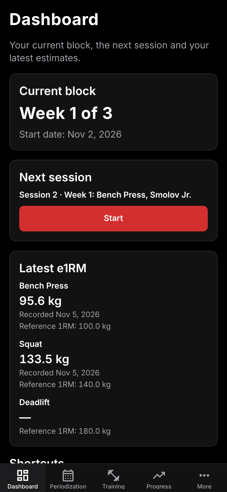
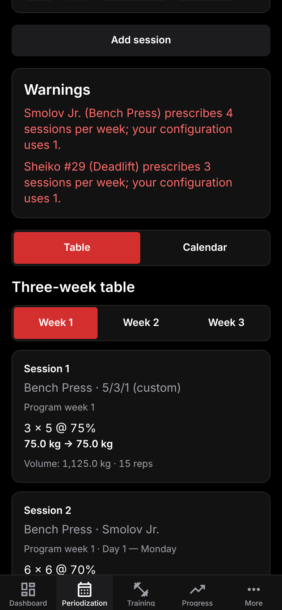
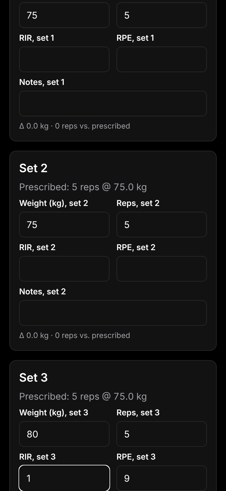
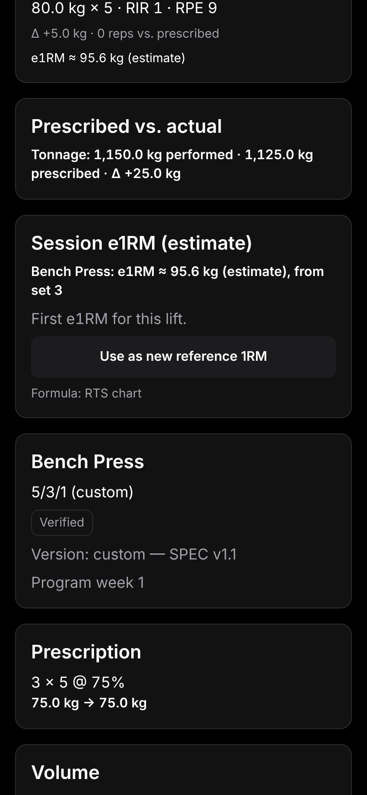
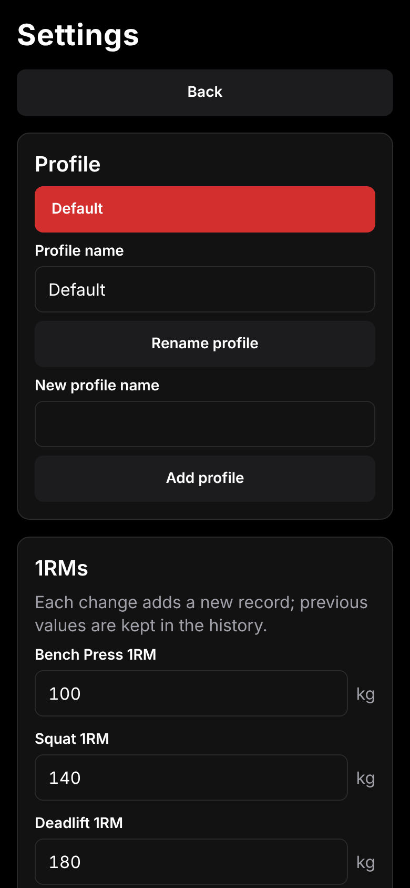
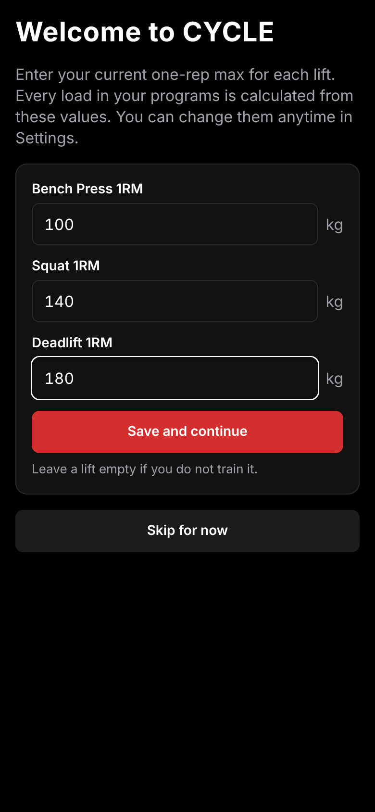
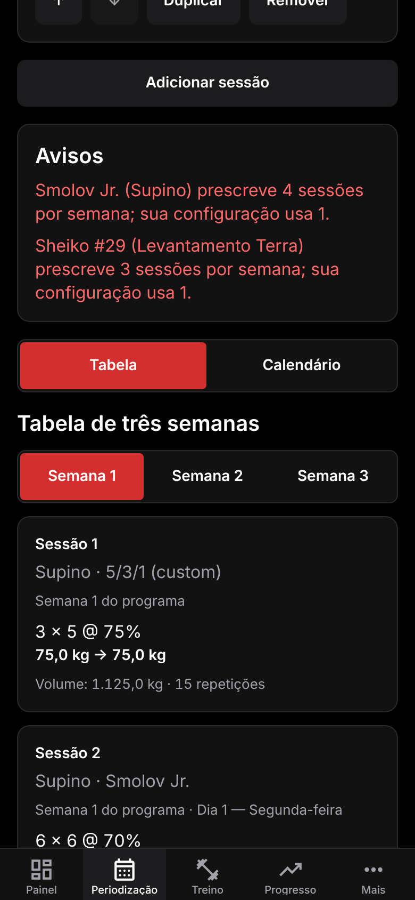
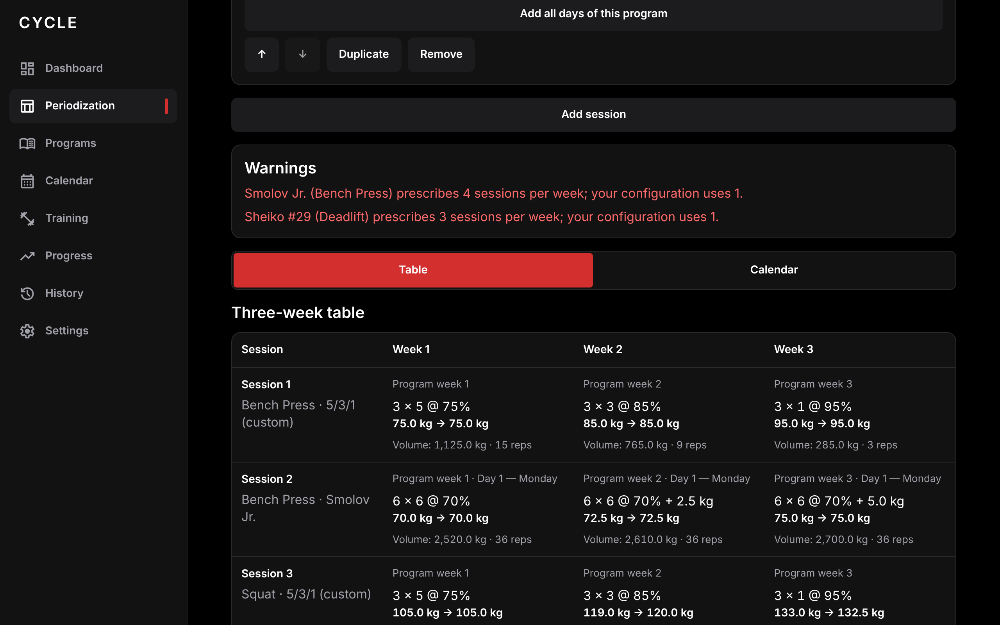
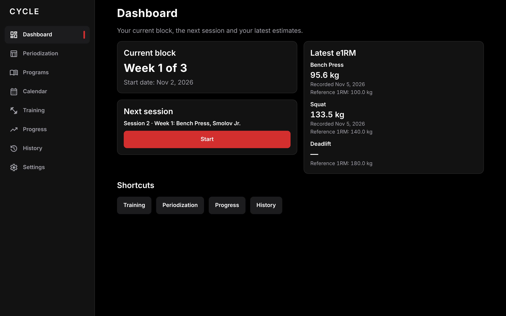

# CYCLE

[](https://github.com/joaov-ferreira/Cycle/actions/workflows/ci.yml)
[](https://github.com/joaov-ferreira/Cycle/actions/workflows/android-apk.yml)

AI powerlifting periodization manager for the bench press, squat and deadlift.

## What is CYCLE

CYCLE helps intermediate and advanced powerlifters plan training periods and track how
their strength changes over time. It is a mobile-first app for iOS, Android and the web,
built with Expo.

Features (see [`docs/SPEC.md`](docs/SPEC.md) for the full specification):

- **Reference 1RMs** per lift (onboarding on first run, editable in Settings), stored as an
  append-only history; several local profiles per device.
- **Program database**: the custom 5/3/1 (editable percentages), Smolov Jr., the full 13-week
  Smolov squat program and five numbered Sheiko routines (#29, #30, #31, #32, #37). Each template
  shows its version, source and verification status; the Programs screen browses the whole
  original structure. Values are transcribed from cited sources (`docs/DECISIONS.md`); anything
  that cannot be verified is marked "Unverified data" and gets no load.
- **Periodization generator**: configure each session of the week (lift, program, program day,
  block start week, program parameters such as the Smolov Jr. increment), reorder, duplicate or
  remove sessions, "Add all days of this program". The three-week table (exact → rounded load,
  volume per session, week and lift, warnings) and the calendar update instantly on every change.
  "Activate periodization" freezes a snapshot with a start date.
- **Load increments and rounding**: 1 / 1.25 / 1.5 / 2 / 2.5 kg or custom (0.1–25 kg), per-lift
  override, nearest (ties down) / always down / always up, computed on integer micrograms.
- **Performance logging** against the activated snapshot: weight, reps, RIR / RPE (kept in sync,
  `5+` accepted), notes, extra sets, autosaved drafts, prescribed vs. actual (Δ kg, Δ reps,
  Δ tonnage), "Complete session".
- **Estimated 1RM (e1RM)**: RTS chart (default), RIR-adjusted Epley or Brzycki; per-set estimates
  while logging, one estimate per lift and session from the representative set, comparison with
  the previous estimate, "Use as new reference 1RM" with confirmation.
- **Dashboard**: current block week, next session, latest e1RM and reference 1RM per lift,
  shortcuts.
- **Progress**: per lift, current reference 1RM, latest / previous / highest e1RM, improvement over
  the baseline of the period, and a chart (e1RM line + reference 1RM steps) with a period filter
  and tappable points.
- **Training history**: completed sessions with lift / program / period filters, set-by-set
  detail, comparison with equivalent previous sessions, and correction of a completed session
  (its e1RM is recomputed as a new revision; nothing else changes).
- **Bilingual interface** (English / Brazilian Portuguese, locale-aware number and date
  formatting), dark theme by default (light option), bottom tabs on phones and a sidebar at
  widths ≥ 900 px.

**Status:** feature-complete for v1 (all stages of [`docs/PLAN.md`](docs/PLAN.md)), with CI and an
automatic Android APK build on every push to `main`. The SPEC §13 acceptance flow is covered by an
end-to-end test (`src/e2e/spec-flow.test.tsx`).

### Screenshots

Taken from the web build (`npx expo start --web`) with the SPEC §13 data (Bench 100, Squat 140,
Deadlift 180 kg; Bench / 5/3/1, Bench / Smolov Jr. day 1, Squat / 5/3/1, Deadlift / Sheiko #29
day 2).

| Dashboard | Three-week table | Calendar |
|---|---|---|
|  |  |  |
| **Logging a session** | **Completed session with e1RM** | **Progress** |
|  |  |  |
| **History** | **Programs** | **Program structure (Sheiko #29)** |
|  |  |  |
| **Settings** | **Onboarding** | **Português** |
|  |  |  |

Wide screens (sidebar):





### Limitations

- **No primary sources for Smolov, Smolov Jr. and Sheiko.** The originals by S. Smolov and
  B. Sheiko could not be retrieved, so these templates are transcribed from consistent secondary
  sources and marked `partial` (details and URLs in `docs/DECISIONS.md`, stages 7–9). Only the
  custom 5/3/1 is `verified` (its source is this project's SPEC).
- **Smolov Jr. increments**: one range (2.5–5 kg per week) applies to bench and squat, because no
  source gives separate upper- and lower-body ranges; week 3 is fixed at twice the weekly
  increment (the sources let the athlete choose the week-3 jump). Not offered for the deadlift.
- **Smolov**: the switching phase (weeks 7–8) has no consistent prescription in the sources, so it
  is shown as unverified text with no load; two disputed sets (week 9 day 1 and week 12 day 3, last
  set) have no percentage. Weeks with three sessions show a rest day in the fourth slot, 1RM tests
  are text, the intense mesocycle uses the current reference 1RM (update it after the week-6
  test), and the non-squat introductory work (e.g. lunges) is not transcribed.
- **Sheiko**: only #29, #30, #31, #32 and #37 are shipped (#39 and #40 had a single readable
  transcription). The #32 max attempts ("2–3 singles at 100–105%") are unverified text with no
  load. Accessories are listed with sets × reps only (never calculated), and on multi-lift days a
  session calculates only its own lift; variations (e.g. deadlift from boxes) use the competition
  lift's 1RM and do not produce an e1RM.
- **RTS chart**: the 2008 printing of *The Reactive Training Manual* was not retrieved; the widely
  circulated Tuchscherer chart is used. Its one disputed cell, 12 reps @ RPE 6 (57.2 % vs 57.4 %),
  is unverified and gives no RTS estimate. The later RTS TRAC table is not used.
- **e1RM validity**: sets with RIR above 4, more than 12 reps to failure or no RIR/RPE are not
  stored (low-confidence values are shown only). RIR `5+` is stored as 5.
- **No session deletion**, no editing of an activated periodization's prescription (activate
  again instead), one record per session of a periodization, and no native date picker (the start
  date is typed as `YYYY-MM-DD`).
- Everything is stored locally (SQLite; WebAssembly on the web): no sync, backup or export; kg only.

## Tech stack and architecture

- Expo SDK 58, React Native 0.88, TypeScript.
- Expo Router for navigation: every file in `src/app/` is a screen, `_layout.tsx` files
  define navigators. Mobile uses five bottom tabs (Dashboard, Periodization, Training,
  Progress, More); at window widths ≥ 900 px the tab bar is replaced by a sidebar (`AppShell`, in the
  root layout) with Dashboard, Periodization, Programs, Calendar, Training, Progress, History and
  Settings. It stays visible on Programs, History, Settings and session detail. Calendar opens
  Periodization with `?view=calendar`.
- `expo-sqlite` for local persistence (native and web), behind repository interfaces.
- `expo-localization` for device locale detection; in-house `t()` for translations.
- `zustand` for app state (stores created per app run, consumed through selectors).
- `jest-expo` + `@testing-library/react-native` for tests.
- `react-native-svg` for the in-house progress charts (no charting library).

Layers (from [SPEC §12.1](docs/SPEC.md#121-layered-architecture-mandatory-separation)):

```
src/
  domain/      # pure math engine: rounding, loads, periodization, rpe, e1rm, stats
  programs/    # program database: schema, data/*.ts, validation, block selection
  data/        # persistence: expo-sqlite, migrations, repositories (interfaces + impl)
  state/       # stores/hooks connecting data ↔ domain ↔ UI
  components/  # reusable UI (tables, cards, charts, numeric inputs)
  i18n/        # translation catalogs, t(), locale detection, formatters
  app/         # Expo Router routes (screens and layouts only)
```

Reference 1RMs (SPEC §2) are validated in `src/domain/validation.ts` (> 0 and ≤ 600 kg, up
to 2 decimals) and stored append-only in `reference_1rm_history`: the repository only adds
records, and the current value is the latest by effective date. Data is scoped by profile;
the active profile is remembered across launches.

Load increments and rounding (SPEC §5) live in `src/domain/rounding.ts`. `roundLoad(kg,
increment, mode)` works in integer micrograms, so ties and exact multiples are decided
without floating-point error. The modes are `nearest` (the default; a tie rounds down, so a
load is never prescribed above its percentage), `down` and `up`. The default increment is
2.5 kg, a preset (1, 1.25, 1.5, 2 or 2.5 kg) or a custom value (0.1–25 kg in 0.05 steps).
Each lift can override the default increment. The settings are stored per profile in
`rounding_settings` and `lift_increment_overrides`.

Program templates (SPEC §3) live in `src/programs/`: the schema (`schema.ts`), one file per
template in `data/`, `validate.ts` (a test validates every registered template and fails if
one omits its source or version), the `registry.ts` (list, find by id, filter by lift),
`blocks.ts` (`getBlock(template, startWeek)`: three consecutive weeks, never compressed,
fewer at the end of the program) and `params.ts` (configurable parameters such as the 5/3/1
percentages, with their allowed range). Parameter values chosen by the athlete are stored
per profile in `program_params`; the template defaults apply until one is saved. Templates so far:
the custom 5/3/1 (`data/cycle-531-custom.ts`), Smolov Jr. (`data/smolov-jr.ts`), Smolov
(`data/smolov.ts`) and the Sheiko routines #29, #30, #31, #32 and #37 (`data/sheiko-<number>.ts`), all
but the first transcribed from the sources listed in `docs/DECISIONS.md` (verification `partial`).
A main item may name a variation of its lift (`exercise`), an informational item may belong to one
lift (`lift`), and templates of one family carry a short `variant` label (`#29`). Besides sets, a program day can hold informational items
(`kind: 'info'`: rest days, max tests, loosely described phases), and an absolute increment can be a
parameter (`addKg: { param, times }`) or fixed by the original (`addKg: { kg }`).

The periodization generator (SPEC §4) is `generatePeriodization(slots, templates, 1RMs,
rounding, params)` in `src/domain/periodization.ts`: pure and synchronous (a test checks that 10 sessions take
less than 50 ms), computing `1RM × percent (+ addKg)` in integer micrograms and rounding with
`roundLoad`. Sets without a confirmed percentage, or whose lift has no 1RM, get no load ("—").
On days that train several lifts (Sheiko), only the slot's lift is calculated; the other lifts' items
are returned as `otherItems` (information, no load or volume).
Warnings are codes that the UI translates. The store exposes it through the memoized
`selectPeriodization` (`src/state/periodization-selectors.ts`). Session slots are stored per
profile in `session_slots`; activated periodizations in `periodizations` (configuration
snapshot) and `generated_sessions` (one JSON snapshot per session). The session detail route
(`/session/<slotId>-w<blockWeek>`) shows a session of the live periodization;
`/session/p<periodizationId>-<slotId>-w<blockWeek>` shows a session of an activated snapshot and is
where performance is logged (SPEC §7). RIR ↔ RPE conversions and the logging rules (field validation,
prescribed-vs-actual, the completion snapshot) are pure code in `src/domain/rpe.ts` and
`src/domain/performance.ts`; drafts and completed sessions are stored in `performed_sessions` and
`performed_sets` (migration 007). The e1RM engine (SPEC §8) is pure code in `src/domain/e1rm/`:
`rts-table.ts` (the RTS RPE chart, reps 1–12 × RPE 10–6, transcribed with its sources; the one cell
the sources disagree on is `unverified`, and the later RTS TRAC table's differences are kept as a note), `estimate.ts` (`rts`: `w / pct(reps, RPE)`, `epley-rir`: `w × (1 + n/30)`,
`brzycki-rir`: `w × 36 / (37 − n)`, with `n = reps + RIR`, rounded to 0.1 kg; validity: at least one
rep, RIR ≤ 4, `n ≤ 12`) and `session.ts` (one estimate per lift from the representative set,
comparison with the previous one). Session estimates are stored in `e1rm_history` (migration 008),
and the formula for new estimates is a per-profile setting. The progression statistics (SPEC §9) are
pure code in `src/domain/stats.ts` (periods, current / latest / previous / highest, Δ kg and Δ % against
the baseline of the period) and the chart's scales, ticks and coordinates in `src/domain/chart-scale.ts`;
`src/components/progress/` only draws them. The history rules (ordering, filters, equivalent sessions,
set summaries) are pure code in `src/domain/history.ts`. `e1rm_history` is an append-only log of revisions
since migration 009: the current estimate of a session is its highest revision, and editing a completed
session (`PerformanceRepository.amend`) appends a newer revision instead of rewriting rows.

Supporting folders: `src/constants/theme.ts` (design tokens) and `src/test-utils/`
(test-only helpers). Each layer has a `README.md` describing its contents and dependency
rules.

Dependency rules:

- `domain/` and `programs/` are pure TypeScript: they do not import React, Expo, `data/`
  or `i18n/`.
- `data/` exposes repository interfaces; tests use an in-memory implementation.
- `app/` contains only routes and layouts. Components, hooks and utilities live outside it.
- No random or mock values in production code.

## Running the app

Prerequisites: Node.js 22 (22.13 or later, for the test suite) with npm 10 (the version this project is developed with), and
either [Expo Go](https://expo.dev/go) on a phone or an iOS/Android simulator or emulator.
Native modules added in later stages may require a development build (see
[`AGENTS.md`](AGENTS.md)).

```bash
npm ci               # install exact dependencies from package-lock.json
npx expo start       # start the dev server; scan the QR code with Expo Go, or press a / i / w
npx expo start --web # open the app in the browser
npx expo lint        # lint
npx tsc --noEmit     # typecheck
npm test             # run the test suite
```

On the web, the database runs on SQLite compiled to WebAssembly. It needs cross-origin
isolation: `metro.config.js` adds the `Cross-Origin-Embedder-Policy: credentialless` and
`Cross-Origin-Opener-Policy: same-origin` headers in development, and any server that hosts
an exported web build must send the same headers. The web build is a single-page app
(`web.output: "single"`).

## Tests

Tests use Jest with the `jest-expo` preset and `@testing-library/react-native`. Test files
live next to the code they test (`*.test.ts` / `*.test.tsx` under `src/`).

```bash
npm test                          # run all tests once
npm run test:watch                # re-run on change
npm run test:coverage             # with coverage report and thresholds
npm test -- src/i18n              # only the tests under a path
```

Coverage thresholds (`jest.config.js`, SPEC §12.3): at least 80% of lines globally, and at
least 95% in `src/domain/` and `src/programs/` once those folders contain code.

Testing strategy:

- Pure logic (`src/domain/`, `src/programs/`) has unit tests with hand-computed expected
  values.
- Persistence: repositories are written against interfaces in `src/data/`. One behavioral
  contract suite runs against both the in-memory implementation and the SQLite
  implementation. In Jest, SQLite runs on Node's built-in `node:sqlite` module through
  `src/test-utils/node-sqlite.ts`, so tests need Node.js 22.13 or later. Migrations are
  tested on a real SQLite engine too.
- UI: behavior and accessible queries (no markup snapshots). Screens with formatted numbers
  are tested in both `en` and `pt-BR`.

The project follows test-driven development; see [`AGENTS.md`](AGENTS.md).

Add dependencies with `npx expo install <package>` (not `npm install`), so the versions match
the Expo SDK.

## Building the APK

Every push to `main` builds an Android APK inside a Docker container on GitHub Actions
(`.github/workflows/android-apk.yml`). Native projects are generated with `npx expo prebuild`
(Continuous Native Generation) in the container and are never committed.

### Download

- **Latest build of `main`**: the
  [`latest-main` pre-release](https://github.com/joaov-ferreira/Cycle/releases/tag/latest-main)
  always holds the APK of the newest commit on `main`.
- **Actions artifact**: open a run of the
  [Android APK workflow](https://github.com/joaov-ferreira/Cycle/actions/workflows/android-apk.yml)
  and download `cycle-apk` (kept for 30 days). Run the workflow manually with "Run workflow", or
  add the `build-apk` label to a pull request to build one without publishing.

File names are `cycle-<version>-<short-sha>.apk` (release keystore) or
`cycle-<version>-<short-sha>-unsigned-debugkey.apk`: signed with the debug key, a test build only.

### Install on a device

Copy the APK to the phone (or download it there), open it and allow "Install unknown apps" for
the app you opened it from, or install over USB with `adb install cycle-<...>.apk`. Updates only
install over a build signed with the same key, so uninstall first when switching between a
debug-key build and a release-key build (this erases the local data).

### Release signing

Without secrets the APK is signed with the debug keystore. To sign with your own key, create a
keystore once and add four repository secrets (Settings, Secrets and variables, Actions):

```bash
keytool -genkeypair -v -storetype PKCS12 -keystore cycle-release.jks -alias cycle \
  -keyalg RSA -keysize 2048 -validity 10000
base64 -w0 cycle-release.jks   # value of ANDROID_KEYSTORE_BASE64 (macOS: base64 -i cycle-release.jks)
```

`ANDROID_KEYSTORE_BASE64`, `ANDROID_KEYSTORE_PASSWORD`, `ANDROID_KEY_ALIAS` and
`ANDROID_KEY_PASSWORD`. Keep the keystore safe: losing it means users must uninstall to update.
The signing configuration is added to the generated Gradle project by the config plugin
`plugins/with-release-signing.js` from Gradle properties passed at build time; no native file is
edited by hand.

### Build locally with Docker

Requires only Docker (no Android Studio). The image (`docker/android/Dockerfile`) pins JDK 17,
Node 22, Android platform 37, build-tools 37.0.0, NDK 27.1.12297006 and CMake 3.30.5.

```bash
docker build -t cycle-android docker/android
docker run --rm --user "$(id -u):$(id -g)" -v "$PWD":/app cycle-android
ls dist/        # cycle-1.0.0-<short-sha>-unsigned-debugkey.apk
```

The first build downloads Gradle and the Android dependencies (several GB, 15 to 30 minutes);
mount `-v cycle-gradle:/home/builder/.gradle` to keep the Gradle cache between runs. To sign with
a release key, add `-e ANDROID_KEYSTORE_BASE64 -e ANDROID_KEYSTORE_PASSWORD -e ANDROID_KEY_ALIAS
-e ANDROID_KEY_PASSWORD` with the same values as the secrets above. Set `CYCLE_ABIS` (default
`arm64-v8a,armeabi-v7a`) to change the target architectures, for example `-e CYCLE_ABIS=x86_64`
for an emulator.

### Alternative: EAS Build

```bash
npx eas-cli@latest build -p android --profile preview
```

This requires an Expo account. The repository does not contain an `eas.json`, so run
`npx eas-cli@latest build:configure` first (or let the build command prompt you to set it up).

### CI

`.github/workflows/ci.yml` runs on every pull request and push to `main`: `npm ci`,
`npx expo lint`, `npx tsc --noEmit`, `npm test -- --coverage` (thresholds enforced), plus
`shellcheck` on `scripts/` and `actionlint` on the workflows. Node comes from `.nvmrc`.

## Project documents

- [`docs/SPEC.md`](docs/SPEC.md): functional and technical specification (source of truth).
- [`docs/PLAN.md`](docs/PLAN.md): staged implementation plan and status table.
- [`docs/DECISIONS.md`](docs/DECISIONS.md): log of architecture and data-source decisions
  (append only).
- [`AGENTS.md`](AGENTS.md): development rules: TDD, Conventional Commits, branch and PR
  workflow, and Expo guidelines.

## Internationalization

The app is bilingual: English (`en`, the source catalog) and Brazilian Portuguese (`pt-BR`).
The language defaults to the device locale (`pt*` → Portuguese, anything else → English).
The per-profile `language` setting (`system`, `en` or `pt-BR`) overrides the device locale
and applies right away, without a restart. Choose it in More → Settings → Language.

### Adding a string

1. Add the key to `src/i18n/locales/en.ts` (the source catalog). Group keys by feature,
   for example `screens.training.title`.
2. Add the same key to `src/i18n/locales/pt-BR.ts`. The catalog is typed against `en`,
   so a missing or extra key fails `npx tsc --noEmit`, and `src/i18n/catalogs.test.ts`
   fails if the keys or `{{placeholders}}` differ between the two catalogs.
3. Use it in a component:

   ```tsx
   import { useT } from '@/i18n';

   const t = useT();
   <Text>{t('screens.training.title')}</Text>;
   ```

Placeholders use `{{name}}`: `t('validation.aboveMax', { max: 600 })`. Number params are
formatted for the locale (`1,500` / `1.500`). Plurals are objects with `one` and `other`
forms, selected by `params.count` (Portuguese treats 0 and 1 as singular):
`t('validation.tooManyDecimals', { count: 2 })`.

`src/i18n/no-hardcoded-strings.test.ts` scans `src/app` and `src/components` and fails on JSX text,
string literals rendered as children and literal `label`, `accessibilityLabel`, `placeholder` or
`title` props that contain letters: such text must come from `t()`.

### Formatting numbers and dates

Use the formatters from `useI18n()`: `formatKg(96.25)` gives `96.25 kg` in English and
`96,25 kg` in Portuguese. There are also `formatNumber`, `formatPercent` and `formatDate`.
Numeric inputs (`NumberInput`) accept the locale's decimal separator, and in Portuguese
both `,` and `.`. Domain code returns error codes, and the UI turns them into localized
messages.

## License

Released under the MIT License. See [`LICENSE`](LICENSE).
