# CYCLE

[](https://github.com/joaov-ferreira/Cycle/actions/workflows/ci.yml)
[](https://github.com/joaov-ferreira/Cycle/actions/workflows/android-apk.yml)

A weight-training logbook with load/deload cycles and automatic load progression. It runs on
Android, iOS and the web (Expo / React Native), works fully offline and keeps everything on the
device. The interface is in English and Brazilian Portuguese.

<p>
  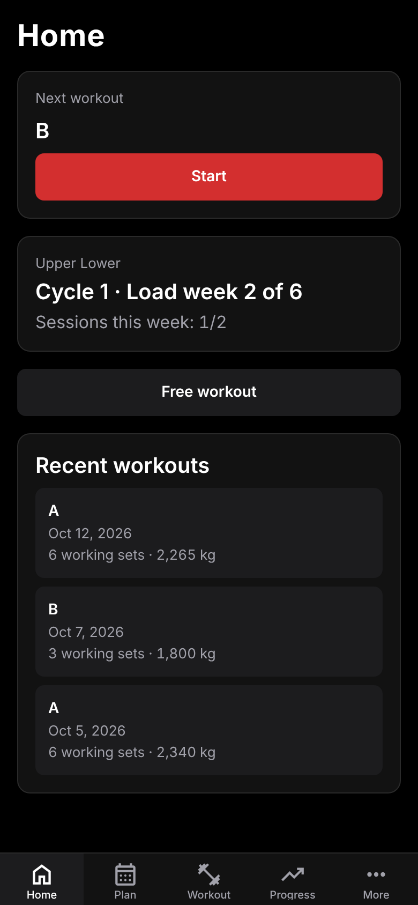
  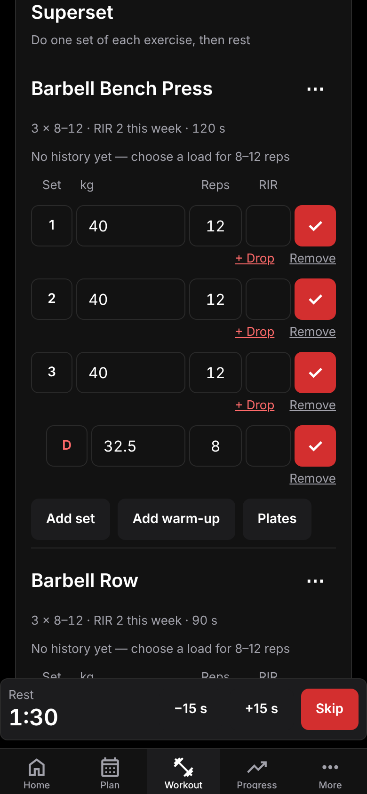
  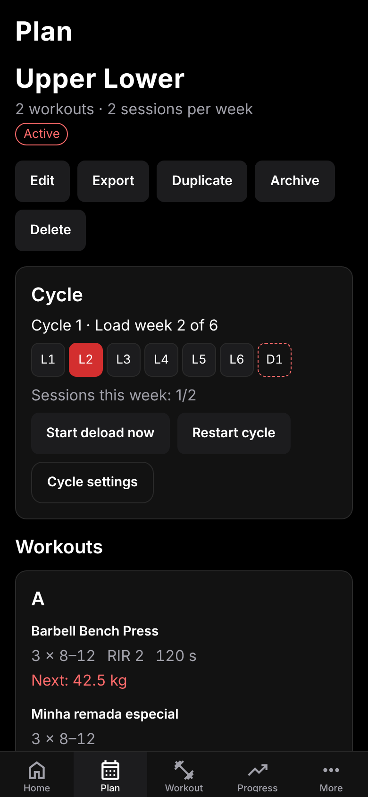
  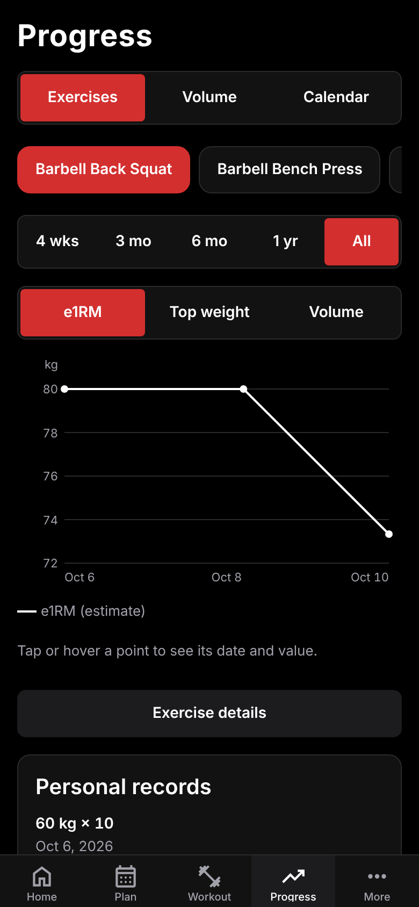
</p>

## What is CYCLE

CYCLE v2 is a general weight-training app (it replaces the v1 powerlifting periodization manager).

- **Exercise library:** more than 150 built-in exercises with English and Portuguese names, filters by
  muscle group and equipment, and your own custom exercises.
- **Plans:** start from a built-in template, import a plan (plain text or JSON, pasted or from a file,
  or written by an AI chatbot) or build it in the editor.
- **Load/deload cycles:** every plan has N load weeks followed by a deload. The app suggests a cycle for
  your experience level, tracks where you are, prescribes the deload and suggests an early deload when
  progress stalls.
- **Logbook:** log each session set by set (weight, reps, optional RIR, warm-ups, notes). A draft survives
  closing the app.
- **Automatic load progression:** for every exercise the app suggests the next load and reps from your
  history and explains why.
- **History and progress:** past workouts (editable), per-exercise charts (e1RM, top weight, volume),
  personal records and weekly sets per muscle group.

The product is specified in [`docs/SPEC.md`](docs/SPEC.md) (source of truth).

## Screenshots

| | | |
|---|---|---|
|  |  | 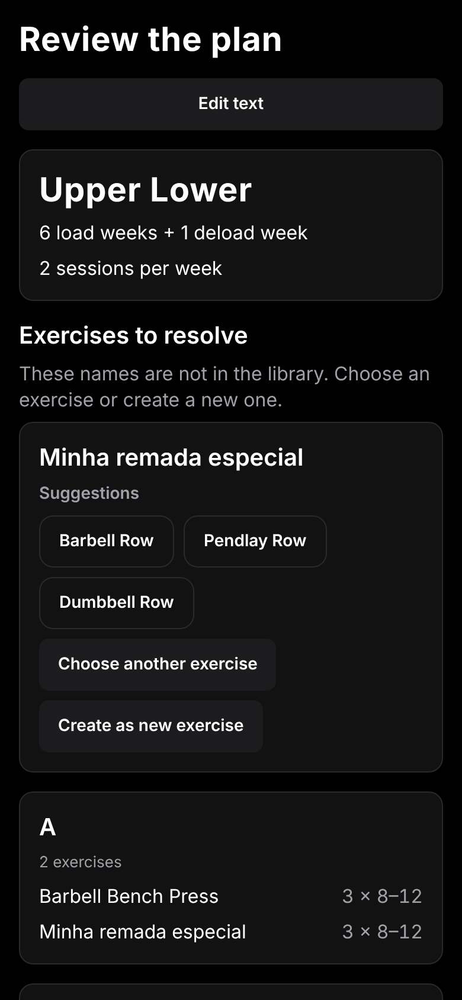 |
| Home | Plan and cycle card | Import preview |
| 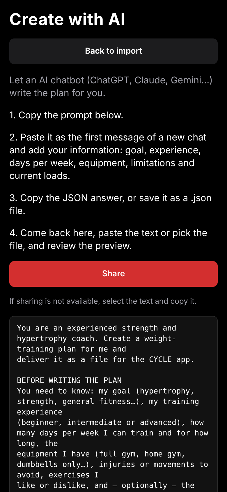 |  | 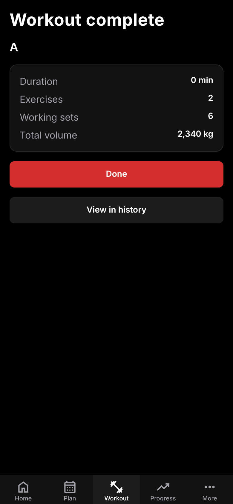 |
| Create with AI | Workout logger | Workout summary |
| 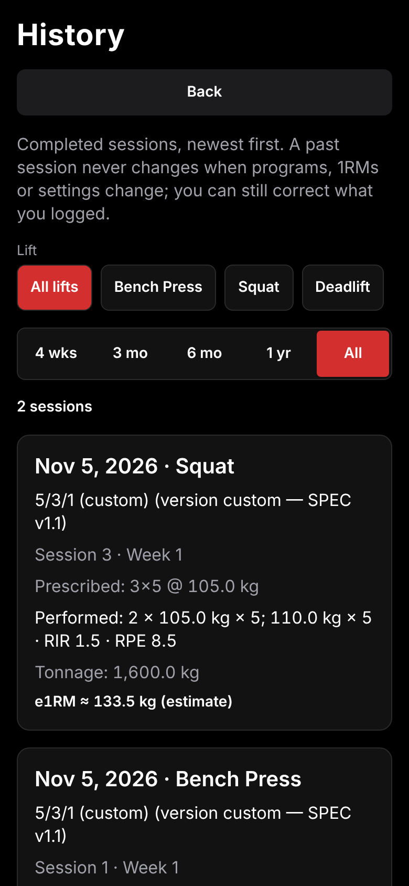 |  | 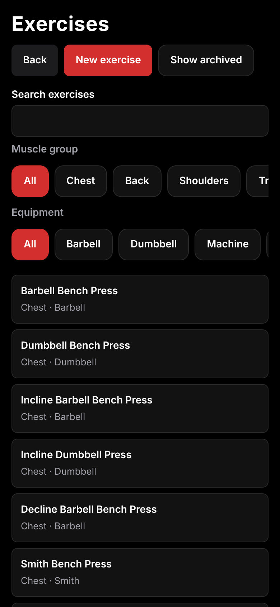 |
| History | Progress | Exercises |
| 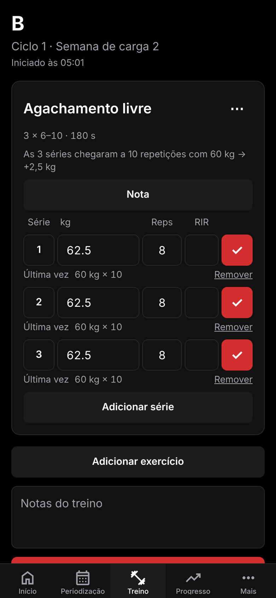 | 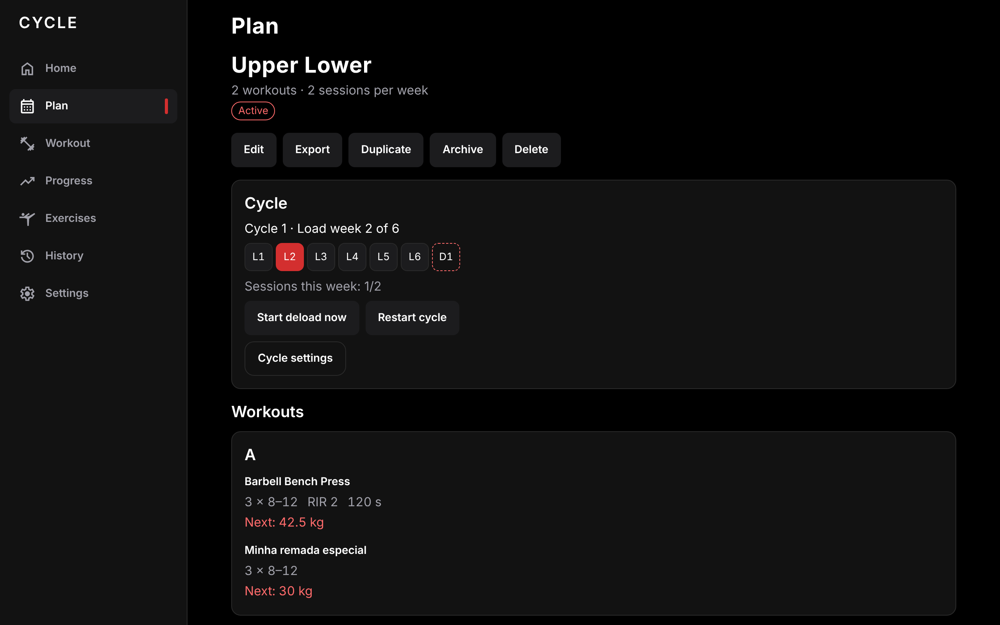 | |
| Portuguese UI (`pt-BR`) | Wide screens get a sidebar | |

## How load progression works

CYCLE uses **double progression with RIR-based autoregulation** (SPEC §6). Every exercise of a plan has
a rep range, for example 3 sets of 8-12. You first add **reps** at a fixed load; when **every set reaches
the top of the range** the **load** goes up and the reps restart at the bottom. It needs no 1RM test and
works for any exercise. Only working sets count (warm-ups never do). The rules, first match wins:

1. **No history:** no load is suggested (or the plan's optional start load); you choose one.
2. **Top of the range:** all planned sets reached the maximum reps at the same load, so the load rises by
   one increment (2.5 kg barbell, 5 kg machine or cable, 1 kg dumbbell; editable per exercise). If you
   also logged RIR at least 2 above the target on every set, it rises by two increments.
3. **Below the range:** at least half of the sets missed the minimum reps, so you repeat the load. Two
   sessions in a row below the range lower the load by about 10 % (rounded to the increment).
4. **Otherwise:** same load, one more rep per set (never above the maximum).
5. Three sessions without improvement flag the exercise as **stalled**.

**Worked example** (3 × 8-12, barbell, 2.5 kg increment): you log 40 kg × 12, 12, 12. Next time the
app suggests **42.5 kg**, aiming for 8 reps per set, and says "All 3 sets reached 12 reps at 40 kg →
+2.5 kg". If you had logged 40 kg × 12, 10, 9 it would suggest 40 kg again with 12, 11, 10 reps.

**Deload week.** After the last load week of the cycle the plan enters the deload phase. Each exercise
keeps about half of its sets (default `0.5`, rounded up) at about 90 % of the last load-phase work
load, rounded to the increment: a 42.5 kg work load becomes 37.5 kg, 2 sets of the minimum reps.
After the deload a new cycle starts.

**Early deload advice.** When at least two exercises (and at least half of those with 3 or more
sessions this cycle) are stalled, the Plan and Home screens suggest a deload now. It is only a
suggestion: start it with one tap or dismiss it. The cycle length (load weeks, deload weeks, volume and
load reduction) is editable per plan; the app proposes 8 / 6 / 4 load weeks for beginner / intermediate
/ advanced lifters. A training week is a number of completed sessions (`sessions per week`), not a
calendar week.

## Plan import formats

Plan → New plan → Import accepts pasted text or a `.json` / `.txt` file (up to 256 KB). Exercise names
are matched exactly (ignoring case, accents and punctuation) against the library, both languages and
aliases. A name that does not match is never guessed: the preview asks you to pick an existing exercise
or create a custom one.

**Plain text** (easy to type in a notes app):

```text
# Upper / Lower
cycle: 5+1
sessions: 4

## Upper A
Barbell Bench Press | 4x6-10 | rir 2 | rest 150
Barbell Row | 4x8-12
- Dumbbell Curl | 3x12 | keep elbows still

## Lower A
Barbell Back Squat | 4x6-10
```

`# name` is the plan, `## name` starts a workout, `cycle: <load>+<deload>` and `sessions: <n>` are
optional, and each exercise line is `name | sets x min-max` followed by optional `rir n`, `rest seconds`
and a note. Portuguese keywords (`ciclo:`, `sessoes:`, `descanso`) work too.

**JSON** (`cycle-plan`, version 1):

```json
{
  "format": "cycle-plan",
  "version": 1,
  "name": "Upper / Lower",
  "sessionsPerWeek": 4,
  "cycle": { "loadWeeks": 5, "deloadWeeks": 1 },
  "workouts": [
    { "name": "Upper A", "exercises": [
      { "exercise": "barbell-bench-press", "sets": 4, "reps": "6-10", "rir": 2, "rest": 150, "startLoad": 60 },
      { "exercise": "Rosca direta", "sets": 3, "reps": 12 }
    ] }
  ]
}
```

The full data specification (every property, limit, default and error code) is
[`docs/IMPORT_FORMAT.md`](docs/IMPORT_FORMAT.md); the JSON Schema is
[`docs/cycle-plan.schema.json`](docs/cycle-plan.schema.json). Export (Plan → Export) produces the same
JSON, and importing it again gives the same plan.

## Create a plan with an AI chatbot

Any AI assistant can write the plan file for you:

1. **Copy the prompt.** Open [`docs/AI_PLAN_PROMPT.md`](docs/AI_PLAN_PROMPT.md) (English) or
   [`docs/AI_PLAN_PROMPT.pt-BR.md`](docs/AI_PLAN_PROMPT.pt-BR.md) (Portuguese), or, in the app, go to
   Plan → New → Import → **Create with AI**. The in-app prompt also lists your own custom exercises.
2. **Paste it as the first message of a new chat** in ChatGPT, Claude, Gemini or any assistant, and add
   your information: goal, experience, days per week, equipment, limitations and current loads. The
   assistant asks for whatever is missing.
3. **Copy the JSON answer** (or save it as a `.json` file). The importer accepts the answer as pasted,
   including the surrounding text and the code fence.
4. **Import it in the app:** Plan → New → Import → paste the text or pick the file, review the preview
   (map or create any exercise the app does not know), then save and activate.

What to type after the prompt, for example:

```text
Goal: hypertrophy. Experience: intermediate (2 years). I can train 4 days a week for 60 minutes.
Equipment: full gym. Left shoulder is sensitive: no behind-the-neck presses.
Current loads: bench press 70 kg for 8, squat 100 kg for 6.
```

The prompt files are generated from the exercise library; after changing the library run
`npm run docs:prompt` to regenerate them (a test fails when they are stale).

## Tech stack and architecture

- Expo SDK 58, React Native 0.88, TypeScript; Expo Router (every file in `src/app/` is a screen).
  Phones use five bottom tabs (Home, Plan, Workout, Progress, More); at widths of 900 px or more a
  sidebar replaces the tab bar.
- `expo-sqlite` for local persistence (native and web) behind repository interfaces,
  `expo-document-picker` to pick plan files, `zustand` for app state, in-house `t()` for translations,
  `react-native-svg` for the charts, `jest-expo` + `@testing-library/react-native` for tests.

Layers (SPEC §11.1); each folder has a `README.md`:

```
src/
  domain/      # pure logic: exercises, plans, import/export, cycle, progression, metrics, stats
  library/     # pure data: the built-in exercises, plan templates, the AI prompt builder
  data/        # persistence: SQLite, migrations, repositories (interfaces + memory + SQLite)
  state/       # zustand store and selectors connecting data, domain and UI
  components/  # UI: one folder per feature
  i18n/        # catalogs per namespace and locale, t(), formatters
  app/         # Expo Router routes (screens and layouts only)
```

`domain/` and `library/` are pure TypeScript (no React, Expo, data or i18n imports) and return codes,
never display strings. `src/library/` holds the exercise registry (`listExercises()`,
`findExercise(id)`), the six plan templates and `buildAiPlanPrompt`. Migrations `001`-`009` (v1) are
immutable. `src/test-utils/` has test-only helpers.

## Running the app

Prerequisites: Node.js 22 (22.13 or later, for the tests) with npm 10, and either
[Expo Go](https://expo.dev/go) on a phone or an iOS/Android simulator or emulator.

```bash
npm ci               # install exact dependencies from package-lock.json
npx expo start       # start the dev server; scan the QR code with Expo Go, or press a / i / w
npx expo start --web # open the app in the browser
npx expo lint        # lint
npx tsc --noEmit     # typecheck
npm test             # run the test suite
npm run docs:prompt  # regenerate docs/AI_PLAN_PROMPT*.md
```

Add dependencies with `npx expo install <package>` so versions match the Expo SDK. On the web the
database runs on SQLite compiled to WebAssembly and needs cross-origin isolation: `metro.config.js`
adds the `Cross-Origin-Embedder-Policy: credentialless` and `Cross-Origin-Opener-Policy: same-origin`
headers in development, and a server hosting an exported web build must send the same headers.

## Tests

Jest with `jest-expo` and `@testing-library/react-native`; test files sit next to the code
(`*.test.ts` / `*.test.tsx`).

```bash
npm test                          # run all tests once
npm run test:watch                # re-run on change
npm run test:coverage             # coverage report and thresholds
npm test -- src/i18n              # only the tests under a path
```

Thresholds (`jest.config.js`): 80 % of lines globally, 95 % in `src/domain/` and `src/library/`.
Pure logic has exact hand-computed expectations; one repository contract suite runs against the
in-memory and the SQLite implementation (Node's `node:sqlite`); UI tests use accessible queries in both
languages; `src/e2e/spec-flow.test.tsx` drives the whole acceptance flow of SPEC §13 through the real
routes; router tests follow every cross-screen link and an audit checks names, roles and touch targets.
The project follows test-driven development, see [`AGENTS.md`](AGENTS.md).

## Data from v1 and limitations

- Completed v1 sessions already on a device are copied into the v2 logbook by migration `010` (bench,
  squat and deadlift entries); the v1 tables stay untouched.
- Units are kilograms only; there is no cloud sync or account; timed/cardio exercises, a rest timer and
  supersets are out of scope (SPEC §15).
- The app has been verified with automated tests and in a desktop browser, not yet on a physical device.

## Building the APK

Every push to `main` builds an Android APK inside a Docker container on GitHub Actions
(`.github/workflows/android-apk.yml`). Native projects are generated with `npx expo prebuild`
(Continuous Native Generation) in the container and are never committed.

### Download

- **Latest build of `main`**: the
  [`latest-main` pre-release](https://github.com/joaov-ferreira/Cycle/releases/tag/latest-main)
  always holds the APK of the newest commit on `main`.
- **Actions artifact**: open a run of the
  [Android APK workflow](https://github.com/joaov-ferreira/Cycle/actions/workflows/android-apk.yml)
  and download `cycle-apk` (kept for 30 days). Run the workflow manually with "Run workflow", or
  add the `build-apk` label to a pull request to build one without publishing.

File names are `cycle-<version>-<short-sha>.apk` (release keystore) or
`cycle-<version>-<short-sha>-unsigned-debugkey.apk`: signed with the debug key, a test build only.

### Install on a device

Copy the APK to the phone (or download it there), open it and allow "Install unknown apps" for
the app you opened it from, or install over USB with `adb install cycle-<...>.apk`. Updates only
install over a build signed with the same key, so uninstall first when switching between a
debug-key build and a release-key build (this erases the local data).

### Release signing

Without secrets the APK is signed with the debug keystore. To sign with your own key, create a
keystore once and add four repository secrets (Settings, Secrets and variables, Actions):

```bash
keytool -genkeypair -v -storetype PKCS12 -keystore cycle-release.jks -alias cycle \
  -keyalg RSA -keysize 2048 -validity 10000
base64 -w0 cycle-release.jks   # value of ANDROID_KEYSTORE_BASE64 (macOS: base64 -i cycle-release.jks)
```

`ANDROID_KEYSTORE_BASE64`, `ANDROID_KEYSTORE_PASSWORD`, `ANDROID_KEY_ALIAS` and
`ANDROID_KEY_PASSWORD`. Keep the keystore safe: losing it means users must uninstall to update.
The signing configuration is added to the generated Gradle project by the config plugin
`plugins/with-release-signing.js` from Gradle properties passed at build time; no native file is
edited by hand.

### Build locally with Docker

Requires only Docker (no Android Studio). The image (`docker/android/Dockerfile`) pins JDK 17,
Node 22, Android platform 37, build-tools 37.0.0, NDK 27.1.12297006 and CMake 3.30.5.

```bash
docker build -t cycle-android docker/android
docker run --rm --user "$(id -u):$(id -g)" -v "$PWD":/app cycle-android
ls dist/        # cycle-2.0.0-<short-sha>-unsigned-debugkey.apk
```

The first build downloads Gradle and the Android dependencies (several GB, 15 to 30 minutes);
mount `-v cycle-gradle:/home/builder/.gradle` to keep the Gradle cache between runs. To sign with
a release key, add `-e ANDROID_KEYSTORE_BASE64 -e ANDROID_KEYSTORE_PASSWORD -e ANDROID_KEY_ALIAS
-e ANDROID_KEY_PASSWORD` with the same values as the secrets above. Set `CYCLE_ABIS` (default
`arm64-v8a,armeabi-v7a`) to change the target architectures, for example `-e CYCLE_ABIS=x86_64`
for an emulator.

### Alternative: EAS Build

```bash
npx eas-cli@latest build -p android --profile preview
```

This requires an Expo account. The repository does not contain an `eas.json`, so run
`npx eas-cli@latest build:configure` first (or let the build command prompt you to set it up).

### CI

`.github/workflows/ci.yml` runs on every pull request and push to `main`: `npm ci`,
`npx expo lint`, `npx tsc --noEmit`, `npm test -- --coverage` (thresholds enforced), plus
`shellcheck` on `scripts/` and `actionlint` on the workflows. Node comes from `.nvmrc`.

## Project documents

- [`docs/SPEC.md`](docs/SPEC.md): functional and technical specification (source of truth).
- [`docs/PLAN.md`](docs/PLAN.md): staged implementation plan and status.
- [`docs/DECISIONS.md`](docs/DECISIONS.md): architecture and data decisions (append only).
- [`docs/IMPORT_FORMAT.md`](docs/IMPORT_FORMAT.md) and
  [`docs/cycle-plan.schema.json`](docs/cycle-plan.schema.json): the plan file format.
- [`docs/AI_PLAN_PROMPT.md`](docs/AI_PLAN_PROMPT.md), [`docs/AI_PLAN_PROMPT.pt-BR.md`](docs/AI_PLAN_PROMPT.pt-BR.md):
  the chatbot prompts.
- [`AGENTS.md`](AGENTS.md): development rules (TDD, commits, Expo guidelines).

## Internationalization

The app is bilingual: English (`en`, the source catalog) and Brazilian Portuguese (`pt-BR`).
The language defaults to the device locale (`pt*` → Portuguese, anything else → English).
The per-profile `language` setting (`system`, `en` or `pt-BR`) overrides the device locale
and applies right away, without a restart. Choose it in More → Settings → Language.

### Adding a string

Catalogs are split by namespace (`app`, `tabs`, `navigation`, `common`, `home`, `plan`,
`planImport`, `workout`, `history`, `progress`, `exercises`, `picker`, `onboarding`, `settings`,
`profile`, `validation`): one file per namespace and locale, composed in `src/i18n/locales/en.ts`
and `src/i18n/locales/pt-BR.ts`.

1. Add the key to the namespace file in `src/i18n/locales/en/<namespace>.ts` (the source
   catalog), for example `workout.ts` for `workout.title`. A new namespace is a new file in both
   folders, registered in `en.ts`, `pt-BR.ts` and the namespace list in
   `src/i18n/catalogs.test.ts`.
2. Add the same key to `src/i18n/locales/pt-BR/<namespace>.ts`. Each pt-BR namespace is typed
   against its English one, so a missing or extra key fails `npx tsc --noEmit`, and
   `src/i18n/catalogs.test.ts` fails if the keys or `{{placeholders}}` differ between the two
   catalogs.
3. Use it in a component:

   ```tsx
   import { useT } from '@/i18n';

   const t = useT();
   <Text>{t('workout.title')}</Text>;
   ```

Placeholders use `{{name}}`: `t('validation.aboveMax', { max: 600 })`. Number params are
formatted for the locale (`1,500` / `1.500`). Plurals are objects with `one` and `other`
forms, selected by `params.count` (Portuguese treats 0 and 1 as singular):
`t('validation.tooManyDecimals', { count: 2 })`.

`src/i18n/no-hardcoded-strings.test.ts` scans `src/app` and `src/components` and fails on JSX text,
string literals rendered as children and literal `label`, `accessibilityLabel`, `placeholder` or
`title` props that contain letters: such text must come from `t()`.

### Formatting numbers and dates

Use the formatters from `useI18n()`: `formatKg(96.25)` gives `96.25 kg` in English and
`96,25 kg` in Portuguese. There are also `formatNumber`, `formatPercent` and `formatDate`.
Numeric inputs (`NumberInput`) accept the locale's decimal separator, and in Portuguese
both `,` and `.`. Domain code returns error codes, and the UI turns them into localized
messages.

## License

Released under the MIT License. See [`LICENSE`](LICENSE).
