# CYCLE

[](https://github.com/joaov-ferreira/Cycle/actions/workflows/ci.yml)
[](https://github.com/joaov-ferreira/Cycle/actions/workflows/android-apk.yml)

A weight-training logbook with load/deload cycles, automatic load progression and, for strength
training, programs and loads calculated from percentages of your 1RM. It runs on
Android, iOS and the web (Expo / React Native), works fully offline and keeps everything on the
device. The interface is in English and Brazilian Portuguese.

<p>
  
  
  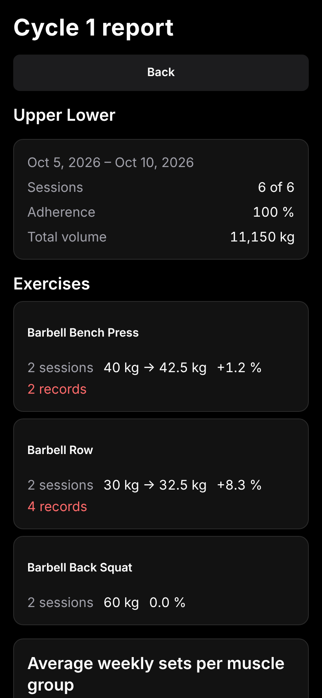
  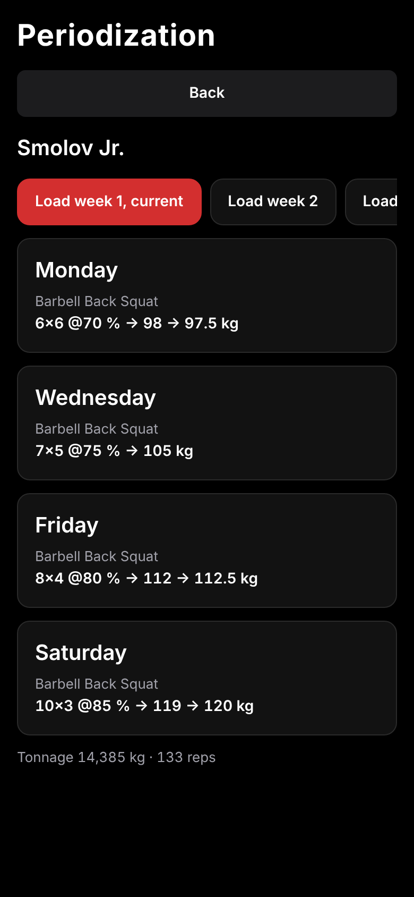
  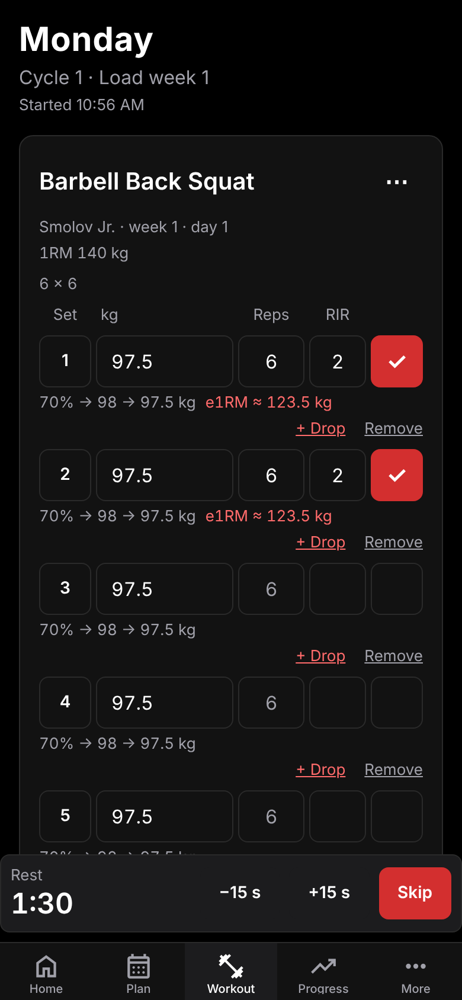
</p>

## What is CYCLE

CYCLE is a weight-training app for two ways of training. If you lift for muscle, health or general
fitness, plan your cycles, log every set and let the app suggest the next load. If you train for strength
(powerlifting or any percentage-based program), keep a reference 1RM per exercise, start a program from
the built-in library and let the app calculate every load. Both mix freely inside one plan. Version 3
added the tools you use during the workout and a loop to improve your plan with an AI assistant;
version 4 adds strength mode.

**Planning**

- **Strength programs:** a library of percentage-based programs (custom 5/3/1, Smolov Jr., Smolov,
  Sheiko), reference 1RMs, percent schemes and a periodization table (see "Strength training and
  programs").
- **Exercise library:** more than 150 built-in exercises with English and Portuguese names, filters by
  muscle group and equipment, and your own custom exercises.
- **Plans:** start from a built-in template, import a plan (plain text or JSON, pasted or from a file,
  or written by an AI chatbot) or build it in the editor.
- **Load/deload cycles:** every plan has N load weeks followed by a deload. The app suggests a cycle for
  your experience level, tracks where you are, prescribes the deload and suggests an early deload when
  progress stalls.
- **Effort ramp:** optionally let the target RIR fall week by week (for example 3 → 0 over the load
  weeks); the Plan screen shows the target of every week and the logger the target of this week.
- **Supersets:** link 2 to 4 consecutive exercises (bi-set, tri-set, giant set) in the editor or the
  import; the logger shows them as one card and rests only after the last exercise of the round.

**During the workout**

- **Logbook:** log each session set by set (weight, reps, optional RIR, notes). A draft survives closing
  the app.
- **Rest timer:** a countdown starts when you mark a set done (default 90 s, or the rest of the plan row),
  with -15 s / +15 s / Skip, a vibration at the end and an optional notification when the app is in the
  background. The screen can stay on during a workout.
- **Plate calculator:** for barbell exercises, the plates to load on each side for the weight of a set
  (configurable bar weight and available plates).
- **Warm-up sets:** one tap adds a warm-up ramp (8 reps at 50 %, 5 at 70 %, 2 at 85 % of the working weight, rounded to the
  exercise's load increment) before the working sets; warm-ups never count in volume or progression.
- **Drop sets:** add a drop set to a working set (pre-filled at 80 % of its weight); it counts in the
  volume but not as a working set.
- **Exercise notes** that stay with an exercise ("seat on position 4"), and **similar exercises** shown
  first when you replace an exercise.
- **Automatic load progression:** for every exercise the app suggests the next load and reps from your
  history and explains why.

**After the workout**

- **Strength dashboard:** a Strength tab in Progress with the reference 1RM, the latest, previous and best
  e1RM, the improvement over a period and a chart; "Use as new 1RM" after a workout that beats it.
- **History and progress:** past workouts (editable, repeatable), per-exercise charts (e1RM, top weight,
  volume), personal records, weekly volume and sets per muscle group, and a calendar with a week streak.
- **Cycle report:** when a cycle ends, a report with adherence, the change of every exercise, stalled
  exercises, records and weekly sets per muscle group; the reports of past cycles stay in the plan.
- **Review with AI:** turns your plan and your results into a prompt for any chatbot and imports the
  improved plan back (see below).
- **Body tracking:** weight, body fat and measurements with charts, change and a 7-day average.
- **Backup and restore:** export everything of a profile to a file and restore it into a new profile;
  export the logbook as CSV.

The product is specified in [`docs/SPEC.md`](docs/SPEC.md) (v2, the base) and
[`docs/SPEC-v3.md`](docs/SPEC-v3.md) and [`docs/SPEC-v4.md`](docs/SPEC-v4.md) (v3 and v4; where they say
otherwise, they win).

## Screenshots

| | | |
|---|---|---|
|  |  |  |
| Home | Plan, cycle card with the RIR of every week | Import preview |
|  |  |  |
| Logger: superset, drop set and rest timer | Workout summary | Cycle report |
| 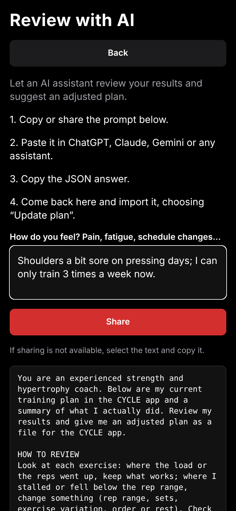 |  |  |
| Review with AI | Create with AI | Progress |
| 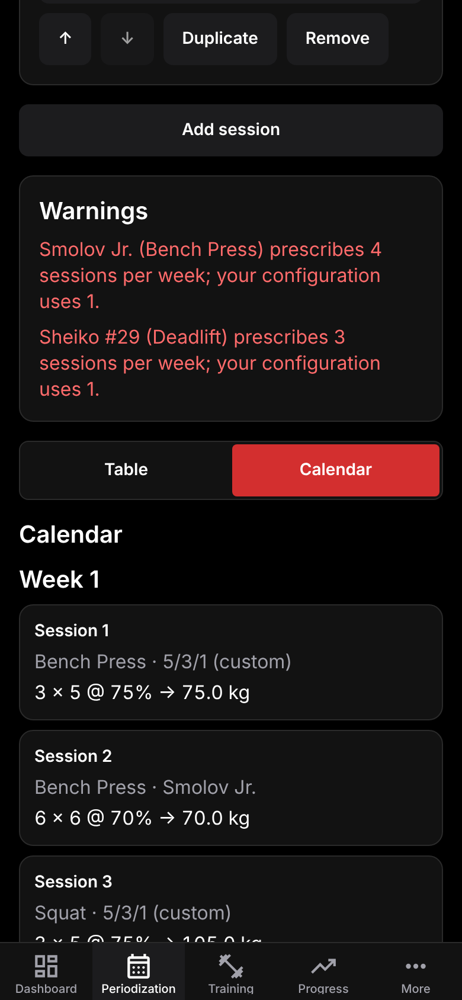 | 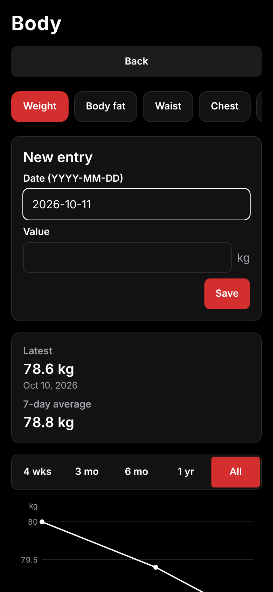 | 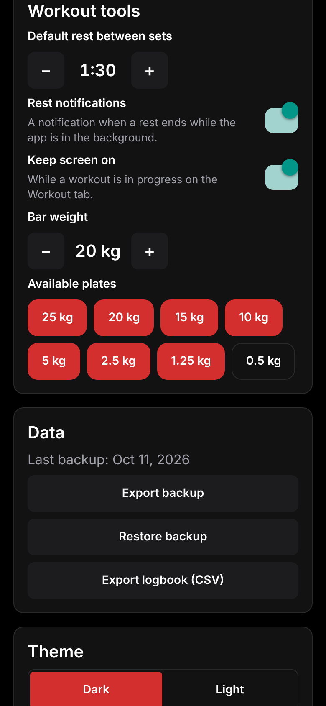 |
| Calendar and streak | Body tracking | Workout tools in Settings |
| 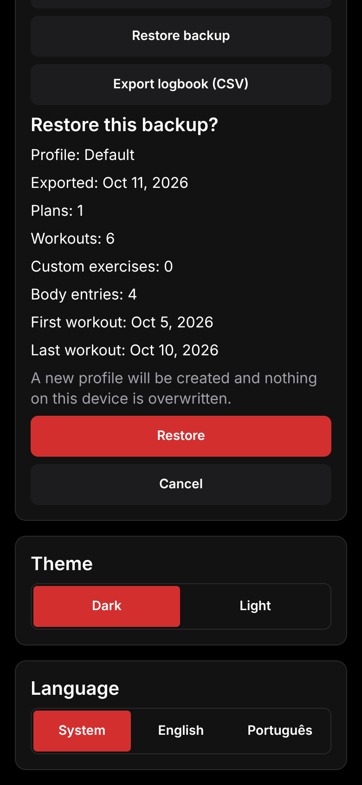 |  |  |
| Restoring a backup | History | Exercises |
|  |  | |
| Portuguese UI (`pt-BR`) | Wide screens get a sidebar | |
| 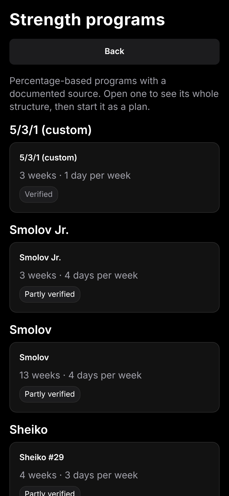 | 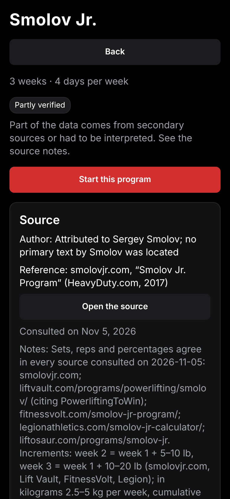 |  |
| Strength program library | A program, week by week, with its source | Periodization table |
|  | 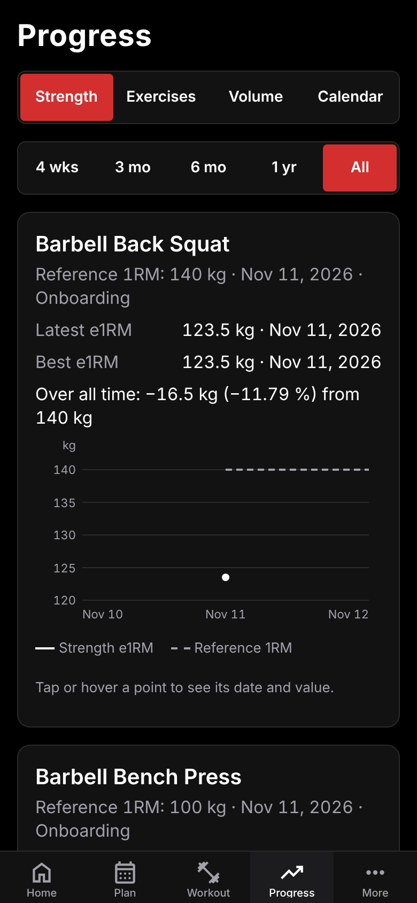 | 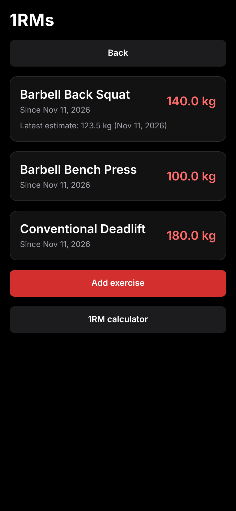 |
| Logger with a percent prescription | Progress, Strength tab | Reference 1RMs |
| 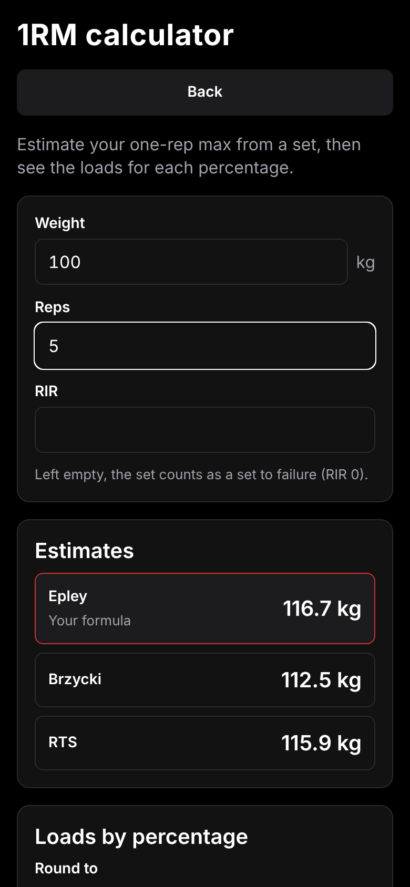 | | |
| 1RM calculator | | |

## Strength training and programs

Strength mode is for powerlifting and any percentage-based program. It is optional: a profile with the
focus "General training" and no 1RM sees none of it (the focus is asked in the onboarding and can be
changed in Settings → Strength).

- **Reference 1RMs, per exercise.** Any library or custom exercise can have a reference 1RM. A change adds
  a record (nothing is overwritten) with its origin (manual, from a workout estimate, onboarding, import);
  More → **1RMs** lists them with their history, and Progress → Strength tracks them.
- **Program library.** More → **Programs** lists custom 5/3/1, Smolov Jr., Smolov and Sheiko #29, #30, #31,
  #32 and #37, each with its source (author, reference, link, access date, notes), version and a
  **verification badge** (verified, partly verified, unverified). The detail screen shows the whole
  original structure week by week. **The numbers of a program are transcriptions of its source and are
  never altered or compressed**; a data test pins every template to a snapshot, and an unverified set
  shows an "Unverified data" badge and gets no calculated load. Programs name *roles* ("the squat of the
  program") that you map to any exercise.
- **Start a program.** The wizard maps the roles to exercises, sets the parameters (for example the Smolov
  Jr. weekly increment), asks for the missing 1RMs and creates a plan with one workout per program day,
  a cycle as long as the program and no deload, then opens its periodization table.
- **Program blocks and percent schemes.** In the plan editor, **Add program block** puts a day of a program
  inside any workout (your own exercises stay below it, on automatic progression), and an exercise can
  switch its **Progression** to **Percent of 1RM**: weeks of sets × reps @ % (optionally ± kg, AMRAP),
  based on its own 1RM or another exercise's. A missing 1RM never blocks you: the exercise shows "Set the
  1RM to get loads" with a one-tap dialog.
- **Periodization table.** Plan → **Periodization table** shows every week of the cycle × every workout with
  sets × reps @ % → exact kg → rounded kg and the weekly tonnage (one week at a time on a phone, all weeks on
  a wide screen). It reads the same data as the logger, so they always agree.
- **How loads are calculated.** `exact = 1RM × percent + kg`, then rounded to the increment of the performed
  exercise (2.5 kg for a barbell by default) with the rounding mode of Settings (nearest, ties down;
  always down; always up): 1RM 105 × 75 % = 78.75 → 77.5 kg; 1RM 140 × 85 % = 119 → 120 kg. The
  tables show exact → rounded when they differ. In a deload week a percent exercise takes week 1 of
  the cycle with fewer sets and lighter loads.
- **Logging a prescription.** The logger opens with weights pre-filled and the reps pre-set: ticking a set
  confirms the prescribed reps (AMRAP sets ask for the reps). With an effort value the row shows
  "e1RM ≈ 96 kg", and the summary compares the session's e1RM with the previous one and the prescribed
  tonnage with the actual one.
- **e1RM formulas and effort.** Settings → Strength chooses the e1RM formula (Epley, the default; Brzycki;
  RTS, from the Reactive Training Systems RPE chart) and the effort scale (RIR or RPE; half points are
  accepted, storage is always RIR). The More → **1RM calculator** shows the estimate under the three
  formulas and the load of every percentage.
- **Use as new 1RM.** When a session's estimate beats the reference 1RM, the summary and the 1RMs screen
  offer it (rounded down to 0.5 kg) after an explicit confirmation; the old value stays in the history.
- **End of a block.** The cycle report gains "Programs and 1RMs": a suggested 1RM per exercise and
  **Continue with the next block** for programs longer than the cycle.

Percent schemes and program blocks can also be imported, exported and written by an AI chatbot (see
below). The full specification is [`docs/SPEC-v4.md`](docs/SPEC-v4.md).

## How load progression works

CYCLE uses **double progression with RIR-based autoregulation** (SPEC §6). Every exercise of a plan has
a rep range, for example 3 sets of 8-12. You first add **reps** at a fixed load; when **every set reaches
the top of the range** the **load** goes up and the reps restart at the bottom. It needs no 1RM test and
works for any exercise. Only working sets count (warm-ups never do). The rules, first match wins:

1. **No history:** no load is suggested (or the plan's optional start load); you choose one.
2. **Top of the range:** all planned sets reached the maximum reps at the same load, so the load rises by
   one increment (2.5 kg barbell, 5 kg machine or cable, 1 kg dumbbell; editable per exercise). If you
   also logged RIR at least 2 above the target on every set, it rises by two increments.
3. **Below the range:** at least half of the sets missed the minimum reps, so you repeat the load. Two
   sessions in a row below the range lower the load by about 10 % (rounded to the increment).
4. **Otherwise:** same load, one more rep per set (never above the maximum).
5. Three sessions without improvement flag the exercise as **stalled**.

**Worked example** (3 × 8-12, barbell, 2.5 kg increment): you log 40 kg × 12, 12, 12. Next time the
app suggests **42.5 kg**, aiming for 8 reps per set, and says "All 3 sets reached 12 reps at 40 kg →
+2.5 kg". If you had logged 40 kg × 12, 10, 9 it would suggest 40 kg again with 12, 11, 10 reps.

**Deload week.** After the last load week of the cycle the plan enters the deload phase. Each exercise
keeps about half of its sets (default `0.5`, rounded up) at about 90 % of the last load-phase work
load, rounded to the increment: a 42.5 kg work load becomes 37.5 kg, 2 sets of the minimum reps.
After the deload a new cycle starts.

**Early deload advice.** When at least two exercises (and at least half of those with 3 or more
sessions this cycle) are stalled, the Plan and Home screens suggest a deload now. It is only a
suggestion: start it with one tap or dismiss it. The cycle length (load weeks, deload weeks, volume and
load reduction) is editable per plan; the app proposes 8 / 6 / 4 load weeks for beginner / intermediate
/ advanced lifters. A training week is a number of completed sessions (`sessions per week`), not a
calendar week.

## Plan import formats

Plan → New plan → Import accepts pasted text or a `.json` / `.txt` file (up to 256 KB). Exercise names
are matched exactly (ignoring case, accents and punctuation) against the library, both languages and
aliases. A name that does not match is never guessed: the preview asks you to pick an existing exercise
or create a custom one.

**Plain text** (easy to type in a notes app):

```text
# Upper / Lower
cycle: 5+1
sessions: 4

## Upper A
Barbell Bench Press | 4x6-10 | rir 2 | rest 150
Barbell Row | 4x8-12
- Dumbbell Curl | 3x12 | keep elbows still

## Lower A
Barbell Back Squat | 4x6-10
```

`# name` is the plan, `## name` starts a workout, `cycle: <load>+<deload>` and `sessions: <n>` are
optional, and each exercise line is `name | sets x min-max` followed by optional `rir n`, `rest seconds`
and a note. Portuguese keywords (`ciclo:`, `sessoes:`, `descanso`) work too. Two additions of v3:

- A line that starts with **`+`** joins the previous exercise in a **superset** (up to 4 exercises):
  `+ Dumbbell Fly | 3x12-15` after the bench press makes a bi-set.
- A line **`rir: 3-0`** next to `cycle:` turns on the **effort ramp**: the target RIR falls from 3 in the
  first load week to 0 in the last one and replaces the `rir` of the rows during the load weeks.

**JSON** (`cycle-plan`, version 1):

```json
{
  "format": "cycle-plan",
  "version": 1,
  "name": "Upper / Lower",
  "sessionsPerWeek": 4,
  "cycle": { "loadWeeks": 5, "deloadWeeks": 1, "rirRamp": { "start": 3, "end": 0 } },
  "workouts": [
    { "name": "Upper A", "exercises": [
      { "exercise": "barbell-bench-press", "sets": 4, "reps": "6-10", "rir": 2, "rest": 150, "startLoad": 60 },
      { "exercise": "Rosca direta", "sets": 3, "reps": 12, "superset": "A" },
      { "exercise": "Tríceps testa", "sets": 3, "reps": 12, "superset": "A" }
    ] }
  ]
}
```

`superset` is a label (up to 10 characters) shared by 2 to 4 **consecutive** exercises of a workout, and
`cycle.rirRamp` (`start` ≥ `end`, both 0-5, or `null`) is the effort ramp. Both are optional.

Version 4 adds three optional parts (files that use them need CYCLE 4.0 or later):

- **`percent`** on an exercise instead of `sets`/`reps`/`rir`: `{ "weeks": [[{ "sets": 3, "reps": 5,
  "percent": 75 }], [{ "sets": 3, "reps": 3, "percent": 85 }]], "of": "barbell-back-squat" }`. Each week is a
  list of groups (`sets`, `reps`, `percent` of the 1RM, optional `addKg` and `amrap`); `of` names the exercise
  whose 1RM is used (default: the exercise itself).
- **`programs`** on a workout: blocks of built-in programs, `{ "program": "smolov-jr", "day": 1, "roles":
  { "lift": "barbell-bench-press" }, "params": { "weeklyIncrementKg": 2.5 } }`.
- **`referenceMaxes`** at the top: `[{ "exercise": "barbell-back-squat", "kg": 140 }]`. A value is saved only
  for an exercise without a 1RM; the preview lists what will be set and what is kept. Export includes the
  1RMs the percent work is based on.

In the text format a **percent line** is `Barbell Back Squat 3x5 @75% / 3x3 @85% / 2x1 @95%, 1x1+ @95%`:
groups are separated by `,`, weeks by `/`, and `+` after the reps marks AMRAP; a single week repeats every
week, and mixing groups with and without `%` is an error.

The full data specification (every property, limit, default and error code) is
[`docs/IMPORT_FORMAT.md`](docs/IMPORT_FORMAT.md); the JSON Schema is
[`docs/cycle-plan.schema.json`](docs/cycle-plan.schema.json). Export (Plan → Export) produces the same
JSON, and importing it again gives the same plan.

## Create a plan with an AI chatbot

Any AI assistant can write the plan file for you:

1. **Copy the prompt.** Open [`docs/AI_PLAN_PROMPT.md`](docs/AI_PLAN_PROMPT.md) (English) or
   [`docs/AI_PLAN_PROMPT.pt-BR.md`](docs/AI_PLAN_PROMPT.pt-BR.md) (Portuguese), or, in the app, go to
   Plan → New → Import → **Create with AI**. The in-app prompt also lists your own custom exercises.
2. **Paste it as the first message of a new chat** in ChatGPT, Claude, Gemini or any assistant, and add
   your information: goal, experience, days per week, equipment, limitations and current loads. The
   assistant asks for whatever is missing.
   For a strength or powerlifting plan the prompt makes the assistant write `percent` schemes (weeks of sets
   × reps @ % of the 1RM) for the main lifts, keep the accessories on rep ranges and add `referenceMaxes`
   only with 1RMs you gave.
3. **Copy the JSON answer** (or save it as a `.json` file). The importer accepts the answer as pasted,
   including the surrounding text and the code fence.
4. **Import it in the app:** Plan → New → Import → paste the text or pick the file, review the preview
   (map or create any exercise the app does not know), then save and activate.

What to type after the prompt, for example:

```text
Goal: hypertrophy. Experience: intermediate (2 years). I can train 4 days a week for 60 minutes.
Equipment: full gym. Left shoulder is sensitive: no behind-the-neck presses.
Current loads: bench press 70 kg for 8, squat 100 kg for 6.
```

The prompt files are generated from the exercise library; after changing the library run
`npm run docs:prompt` to regenerate them (a test fails when they are stale).

## Review your plan with an AI chatbot

Once you have trained for a while, let an assistant review how it went and adjust the plan:

1. **Open the review.** In the app go to Plan → **Review with AI**, or open a cycle report (Home shows a
   "Cycle complete" card when you finish a cycle) and tap **Review with AI**.
2. **Write how you feel** in the notes field: pains, fatigue, schedule changes. Leave it empty if there is
   nothing to say (the assistant then asks).
3. **Copy or share the prompt.** It holds your plan as JSON, a summary of your recent sessions per
   exercise (`40×12@2, 40×12@2, 40×11@1`, `d` marks a drop set), your adherence, the exercises that
   stalled, your weekly sets per muscle group and the exercise list.
4. **Paste it in ChatGPT, Claude, Gemini or any assistant.**
5. **Copy the JSON answer** it gives you.
6. **Import it:** tap **Import the answer** (or Plan → New → Import), paste the answer and choose
   **Update plan**. The workout history and the position in the cycle are kept, and the previous version
   of the plan is archived as "*name* (before update *date*)", so nothing is lost. Choose "Save as a new
   plan" instead to keep both side by side.

Only the plan text and a summary of your training leave the app, and only when you share or copy the
prompt yourself; the app never sends anything to a server.

## Backup and restore

Settings → **Data** has three actions:

- **Export backup** writes `cycle-backup-<profile>-<date>.json` with the whole profile (settings, custom
  exercises, notes, plans and their cycle position, workouts, reference 1RMs, body measurements) and opens the share
  sheet (a download on the web). Home and Settings remind you after 30 days without a backup.
- **Restore backup** reads such a file, shows what it contains and, when you confirm, creates a **new
  profile** named "*name* (restored)" and switches to it. Nothing on the device is overwritten, and a
  failure leaves nothing behind.
- **Export logbook (CSV)** writes one row per logged set (`date,workout,plan,phase,exercise_id,exercise,
  set,kind,weight_kg,reps,rir,prescribed_weight_kg,prescribed_reps,percent`) for spreadsheets; the last
  three are empty for sets without a prescription.

The file is documented in [`docs/BACKUP_FORMAT.md`](docs/BACKUP_FORMAT.md).

## Tech stack and architecture

- Expo SDK 58, React Native 0.88, TypeScript; Expo Router (every file in `src/app/` is a screen).
  Phones use five bottom tabs (Home, Plan, Workout, Progress, More); at widths of 900 px or more a
  sidebar replaces the tab bar.
- `expo-sqlite` for local persistence (native and web) behind repository interfaces,
  `expo-document-picker` to pick plan and backup files, `zustand` for app state, in-house `t()` for
  translations, `react-native-svg` for the charts, `jest-expo` + `@testing-library/react-native` for tests.
- Strength mode (v4) adds no native module.
- Native modules added in v3 (each behind a small adapter in `src/platform/`, a development build or the
  APK is needed, Expo Go ships some of them): `expo-notifications` (rest-end notification),
  `expo-keep-awake` (screen on during a workout), `expo-sharing` and `expo-file-system` (share backups,
  CSV files and prompts).

Layers (SPEC §11.1); each folder has a `README.md`:

```
src/
  domain/      # pure logic: exercises, plans, import/export, cycle, progression, metrics, stats,
               # rest timer, plates, warm-ups, cycle report, backup, body, insights, strength: reference
               # 1RMs, e1RM formulas, percent schemes, programs, prescriptions
  library/     # pure data: exercises, plan templates, strength programs, the AI prompt builders
  data/        # persistence: SQLite, migrations, repositories (interfaces + memory + SQLite)
  state/       # zustand store and selectors connecting data, domain and UI
  platform/    # adapters for native modules: notifications, keep-awake, files, share
  components/  # UI: one folder per feature
  i18n/        # catalogs per namespace and locale, t(), formatters
  app/         # Expo Router routes (screens and layouts only)
```

`domain/` and `library/` are pure TypeScript (no React, Expo, data or i18n imports) and return codes,
never display strings. `src/library/` holds the exercise registry (`listExercises()`,
`findExercise(id)`), the plan templates, the strength programs (`PROGRAMS`, `findProgram`),
`buildAiPlanPrompt` and `buildAiReviewPrompt`. Migrations `001`-`012` are immutable. `src/test-utils/` has test-only helpers.

## Running the app

Prerequisites: Node.js 22 (22.13 or later, for the tests) with npm 10, and either
[Expo Go](https://expo.dev/go) on a phone or an iOS/Android simulator or emulator.

```bash
npm ci               # install exact dependencies from package-lock.json
npx expo start       # start the dev server; scan the QR code with Expo Go, or press a / i / w
npx expo start --web # open the app in the browser
npx expo lint        # lint
npx tsc --noEmit     # typecheck
npm test             # run the test suite
npm run docs:prompt  # regenerate docs/AI_PLAN_PROMPT*.md
```

Add dependencies with `npx expo install <package>` so versions match the Expo SDK. On the web the
database runs on SQLite compiled to WebAssembly and needs cross-origin isolation: `metro.config.js`
adds the `Cross-Origin-Embedder-Policy: credentialless` and `Cross-Origin-Opener-Policy: same-origin`
headers in development, and a server hosting an exported web build must send the same headers.

## Tests

Jest with `jest-expo` and `@testing-library/react-native`; test files sit next to the code
(`*.test.ts` / `*.test.tsx`).

```bash
npm test                          # run all tests once
npm run test:watch                # re-run on change
npm run test:coverage             # coverage report and thresholds
npm test -- src/i18n              # only the tests under a path
```

Thresholds (`jest.config.js`): 80 % of lines globally, 95 % in `src/domain/` and `src/library/`.
Pure logic has exact hand-computed expectations; one repository contract suite runs against the
in-memory and the SQLite implementation (Node's `node:sqlite`); UI tests use accessible queries in both
languages; `src/e2e/spec-flow.test.tsx`, `spec-flow-v3.test.tsx` and `spec-flow-v4.test.tsx` drive the
acceptance flows of SPEC §13, SPEC-v3 §13 and SPEC-v4 §12 through the real routes; router tests follow every cross-screen link and an audit checks names, roles and touch targets.
The project follows test-driven development, see [`AGENTS.md`](AGENTS.md).

## Data from v1 and limitations

- Completed v1 sessions already on a device are copied into the v2 logbook by migration `010` (bench,
  squat and deadlift entries); the v1 tables stay untouched. Migration `012` copies v1 reference 1RMs to
  the per-exercise model and sets such a profile's focus to strength.
- Units are kilograms only; there is no cloud sync or account; timed/cardio exercises, training-day
  reminders and volume ramps are out of scope (SPEC §15, SPEC-v3 §14); so are a three-lift total, Wilks/DOTS, training maxes and editing
  built-in programs (SPEC-v4 §13).
- The app has been verified with automated tests and in a desktop browser, not yet on a physical device.
  In particular the **rest-end notification**, **keep-awake** and the **share sheet / file saving** call
  native modules that only run on a device or emulator: they are covered by tests with fake adapters,
  not by a real device.

## Building the APK

Every push to `main` builds an Android APK inside a Docker container on GitHub Actions
(`.github/workflows/android-apk.yml`). Native projects are generated with `npx expo prebuild`
(Continuous Native Generation) in the container and are never committed.

### Download

- **Latest build of `main`**: the
  [`latest-main` pre-release](https://github.com/joaov-ferreira/Cycle/releases/tag/latest-main)
  always holds the APK of the newest commit on `main`.
- **Actions artifact**: open a run of the
  [Android APK workflow](https://github.com/joaov-ferreira/Cycle/actions/workflows/android-apk.yml)
  and download `cycle-apk` (kept for 30 days). Run the workflow manually with "Run workflow", or
  add the `build-apk` label to a pull request to build one without publishing.

File names are `cycle-<version>-<short-sha>.apk` (release keystore) or
`cycle-<version>-<short-sha>-unsigned-debugkey.apk`: signed with the debug key, a test build only.

### Install on a device

Copy the APK to the phone (or download it there), open it and allow "Install unknown apps" for
the app you opened it from, or install over USB with `adb install cycle-<...>.apk`. Updates only
install over a build signed with the same key, so uninstall first when switching between a
debug-key build and a release-key build (this erases the local data).

### Release signing

Without secrets the APK is signed with the debug keystore. To sign with your own key, create a
keystore once and add four repository secrets (Settings, Secrets and variables, Actions):

```bash
keytool -genkeypair -v -storetype PKCS12 -keystore cycle-release.jks -alias cycle \
  -keyalg RSA -keysize 2048 -validity 10000
base64 -w0 cycle-release.jks   # value of ANDROID_KEYSTORE_BASE64 (macOS: base64 -i cycle-release.jks)
```

`ANDROID_KEYSTORE_BASE64`, `ANDROID_KEYSTORE_PASSWORD`, `ANDROID_KEY_ALIAS` and
`ANDROID_KEY_PASSWORD`. Keep the keystore safe: losing it means users must uninstall to update.
The signing configuration is added to the generated Gradle project by the config plugin
`plugins/with-release-signing.js` from Gradle properties passed at build time; no native file is
edited by hand.

### Build locally with Docker

Requires only Docker (no Android Studio). The image (`docker/android/Dockerfile`) pins JDK 17,
Node 22, Android platform 37, build-tools 37.0.0, NDK 27.1.12297006 and CMake 3.30.5.

```bash
docker build -t cycle-android docker/android
docker run --rm --user "$(id -u):$(id -g)" -v "$PWD":/app cycle-android
ls dist/        # cycle-4.0.0-<short-sha>-unsigned-debugkey.apk
```

The first build downloads Gradle and the Android dependencies (several GB, 15 to 30 minutes);
mount `-v cycle-gradle:/home/builder/.gradle` to keep the Gradle cache between runs. To sign with
a release key, add `-e ANDROID_KEYSTORE_BASE64 -e ANDROID_KEYSTORE_PASSWORD -e ANDROID_KEY_ALIAS
-e ANDROID_KEY_PASSWORD` with the same values as the secrets above. Set `CYCLE_ABIS` (default
`arm64-v8a,armeabi-v7a`) to change the target architectures, for example `-e CYCLE_ABIS=x86_64`
for an emulator.

### Alternative: EAS Build

```bash
npx eas-cli@latest build -p android --profile preview
```

This requires an Expo account. The repository does not contain an `eas.json`, so run
`npx eas-cli@latest build:configure` first (or let the build command prompt you to set it up).

### CI

`.github/workflows/ci.yml` runs on every pull request and push to `main`: `npm ci`,
`npx expo lint`, `npx tsc --noEmit`, `npm test -- --coverage` (thresholds enforced), plus
`shellcheck` on `scripts/` and `actionlint` on the workflows. Node comes from `.nvmrc`.

## Project documents

- [`docs/SPEC.md`](docs/SPEC.md): functional and technical specification (v2, the base).
- [`docs/SPEC-v3.md`](docs/SPEC-v3.md): the v3 specification (supersedes SPEC.md where it differs).
- [`docs/SPEC-v4.md`](docs/SPEC-v4.md): the v4 specification, strength mode (supersedes the others where it differs).
- [`docs/PLAN.md`](docs/PLAN.md): staged implementation plan and status.
- [`docs/DECISIONS.md`](docs/DECISIONS.md): architecture and data decisions (append only).
- [`docs/IMPORT_FORMAT.md`](docs/IMPORT_FORMAT.md) and
  [`docs/cycle-plan.schema.json`](docs/cycle-plan.schema.json): the plan file format.
- [`docs/BACKUP_FORMAT.md`](docs/BACKUP_FORMAT.md): the backup file format.
- [`docs/AI_PLAN_PROMPT.md`](docs/AI_PLAN_PROMPT.md), [`docs/AI_PLAN_PROMPT.pt-BR.md`](docs/AI_PLAN_PROMPT.pt-BR.md):
  the chatbot prompts for creating a plan (the review prompt is built in the app).
- [`AGENTS.md`](AGENTS.md): development rules (TDD, commits, Expo guidelines).

## Internationalization

The app is bilingual: English (`en`, the source catalog) and Brazilian Portuguese (`pt-BR`).
The language defaults to the device locale (`pt*` → Portuguese, anything else → English).
The per-profile `language` setting (`system`, `en` or `pt-BR`) overrides the device locale
and applies right away, without a restart. Choose it in More → Settings → Language.

### Adding a string

Catalogs are split by namespace (`app`, `tabs`, `navigation`, `common`, `home`, `plan`,
`planImport`, `planEditor`, `workout`, `timer`, `tools`, `cycleReport`, `aiReview`, `backup`, `body`,
`insights`, `history`, `progress`, `exercises`, `picker`, `onboarding`, `settings`, `profile`,
`validation`, `programs`, `strength`, `maxes`): one file per namespace and locale, composed in `src/i18n/locales/en.ts`
and `src/i18n/locales/pt-BR.ts`.

1. Add the key to the namespace file in `src/i18n/locales/en/<namespace>.ts` (the source
   catalog), for example `workout.ts` for `workout.title`. A new namespace is a new file in both
   folders, registered in `en.ts`, `pt-BR.ts` and the namespace list in
   `src/i18n/catalogs.test.ts`.
2. Add the same key to `src/i18n/locales/pt-BR/<namespace>.ts`. Each pt-BR namespace is typed
   against its English one, so a missing or extra key fails `npx tsc --noEmit`, and
   `src/i18n/catalogs.test.ts` fails if the keys or `{{placeholders}}` differ between the two
   catalogs.
3. Use it in a component:

   ```tsx
   import { useT } from '@/i18n';

   const t = useT();
   <Text>{t('workout.title')}</Text>;
   ```

Placeholders use `{{name}}`: `t('validation.aboveMax', { max: 600 })`. Number params are
formatted for the locale (`1,500` / `1.500`). Plurals are objects with `one` and `other`
forms, selected by `params.count` (Portuguese treats 0 and 1 as singular):
`t('validation.tooManyDecimals', { count: 2 })`.

`src/i18n/no-hardcoded-strings.test.ts` scans `src/app` and `src/components` and fails on JSX text,
string literals rendered as children and literal `label`, `accessibilityLabel`, `placeholder` or
`title` props that contain letters: such text must come from `t()`.

### Formatting numbers and dates

Use the formatters from `useI18n()`: `formatKg(96.25)` gives `96.25 kg` in English and
`96,25 kg` in Portuguese. There are also `formatNumber`, `formatPercent` and `formatDate`.
Numeric inputs (`NumberInput`) accept the locale's decimal separator, and in Portuguese
both `,` and `.`. Domain code returns error codes, and the UI turns them into localized
messages.

## License

Released under the MIT License. See [`LICENSE`](LICENSE).
